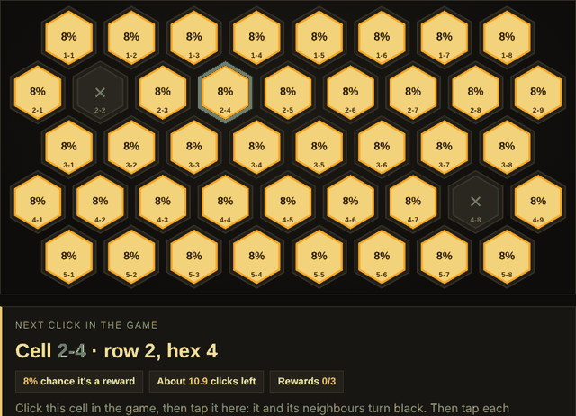
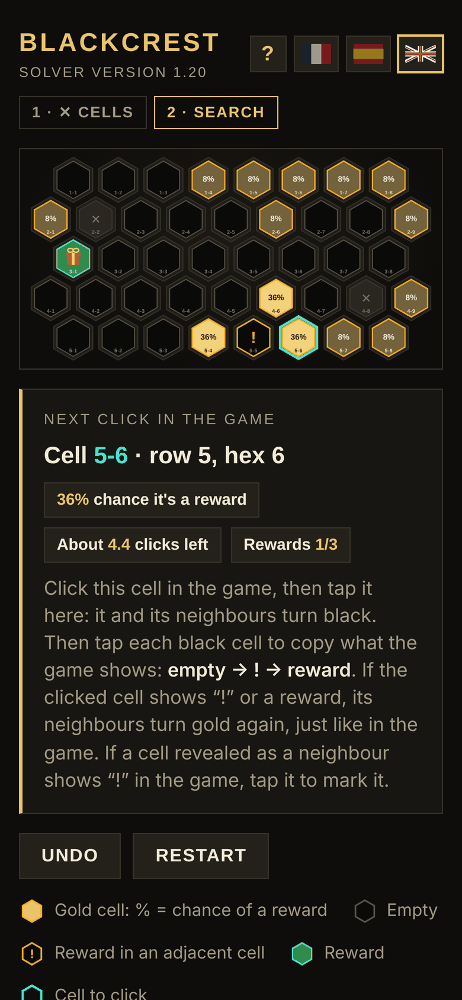
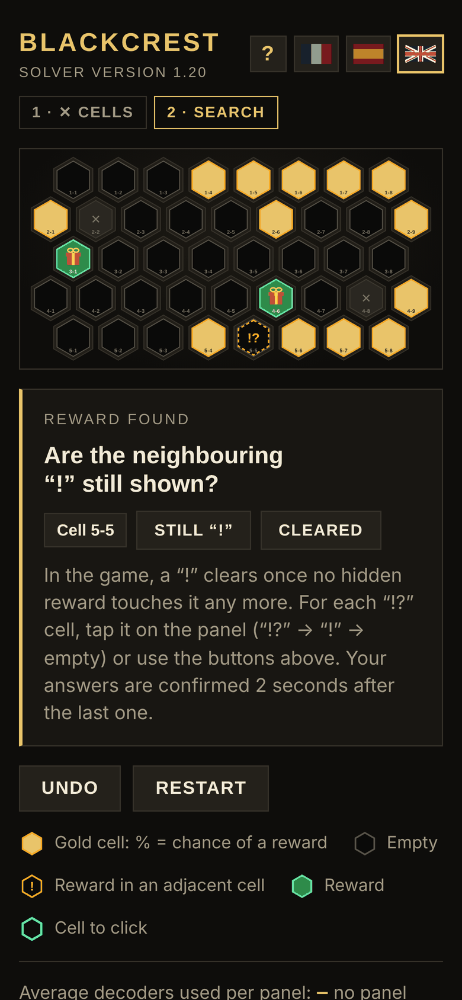
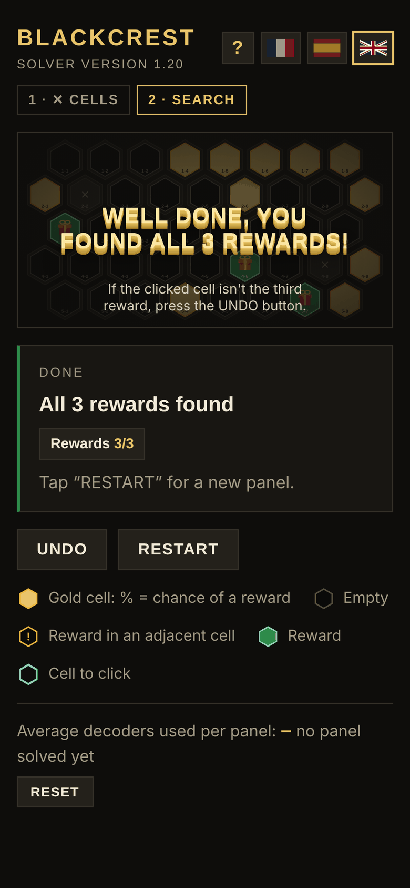
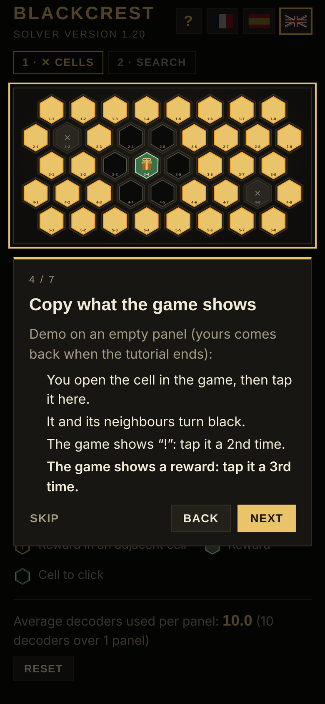
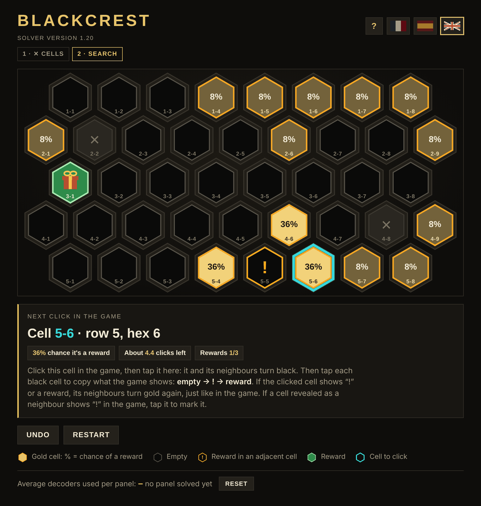

# Blackcrest Solver

**Find the 3 rewards of every Decoder panel in Asphalt Legends' Blackcrest event, using as few decoders as possible.**

A real panel solved in 9 clicks: the solver picks the cell, you copy what the game shows.

### 👉 [blackcrest.gauntlet-manager.com](https://blackcrest.gauntlet-manager.com/)

---

## Why use it?

Decoders are the scarce resource of the Blackcrest event: every decoder you save is a step closer to the next panel, and to the cars.

- 🎯 **The best cell, at every step.** The solver weighs every possible layout of the rewards and looks 3 to 5 clicks ahead.
- 📉 **About 10 decoders per panel on average**, measured over 1,200 simulated panels.
- 🔢 **The odds on every cell**, updated after each click.
- 📊 **Your own statistic**: the average number of decoders you used per solved panel.

## How it works

<table>
<tr>
<td width="33%" align="center"></td>
<td width="33%" align="center"></td>
<td width="33%" align="center"></td>
</tr>
<tr>
<td valign="top"><b>1. Click the blue cell.</b> Tap one of the 2 ✕ cells of your panel (the other is placed automatically), then open in the game the cell circled in blue.</td>
<td valign="top"><b>2. Copy what the game shows.</b> Tap the cell to reveal it, then tap again for <b>!</b> or a reward. After a reward, tell the solver which “!” are still shown.</td>
<td valign="top"><b>3. Collect your 3 rewards.</b> A “Well done” message appears, the panel resets, and your average decoders per panel is updated.</td>
</tr>
</table>

New to the tool? An **interactive tutorial with animated demos** opens on your first visit, and the **?** button replays it at any time.

## Features

| | |
|---|---|
| 🧠 **Smart advice** | Looks several clicks ahead, not just at the most likely cell |
| ❗ **Handles every game rule** | Rewards and “!” reveal only their own cell, “!” clear when their reward is found |
| ✕ **Automatic second ✕** | The game always places it opposite the first one |
| 🔴 **Mistake-proof** | Inconsistent cells are circled in red, and UNDO goes back one step |
| 💾 **Auto-save** | Close the app, come back later: your panel is still there |
| 📱 **Installable app** | Home-screen icon, full screen, works offline |
| 🌍 **3 languages** | English, Français, Español |

## Install it as an app

- **Android (Chrome):** open [the solver](https://blackcrest.gauntlet-manager.com/) and tap **INSTALL**.
- **iPhone (Safari):** tap **Share**, then **Add to Home Screen**.

It then opens full screen from its own icon, even without a connection.

## On a computer

## FAQ

**Is it official?**
No. It's a free, unofficial fan tool, not affiliated with Gameloft.

**Does it read or change the game?**
No. It only uses what the game shows you on screen: you copy each result yourself.

**Why does a panel sometimes take more than 10 decoders?**
10 is an average: depending on where the rewards are, a panel can take from 3 to about 15 decoders. Following the blue cell every time is what keeps the average low.

---

<b>For developers</b>

| File | Role |
|---|---|
| `index.html` | The whole app (HTML, CSS and JavaScript in one file, no dependencies) |
| `manifest.json` | Web app manifest |
| `sw.js` | Service worker: offline use and updates |
| `icons/` | App icons |
| `docs/` | Screenshots and animation for this page |

No build step: serve the folder over HTTPS (Nginx, Apache, GitHub Pages…). The only external resource is Google Fonts.

**Releasing a new version**

1. In `index.html`, update `APP_VERSION` and add an entry at the top of `CHANGELOG` (in the 3 languages): the tutorial then shows what's new to players.
2. In `sw.js`, update `VERSION` so installed apps fetch the new files.
3. For a text-only fix, change only `VERSION` in `sw.js`: the tutorial won't reopen.

<b>🇫🇷 En français</b>

**Blackcrest Solver** est un outil gratuit pour le **Décodeur** de l'événement **Blackcrest** d'*Asphalt Legends*. À chaque coup, il indique la case à ouvrir pour trouver les 3 récompenses d'un panneau avec le moins de décodeurs possible : environ **10 décodeurs par panneau** en moyenne, mesurés sur 1 200 panneaux simulés.

👉 **[blackcrest.gauntlet-manager.com](https://blackcrest.gauntlet-manager.com/)**

- Probabilité de récompense sur chaque case, case conseillée entourée en bleu.
- Calcul qui anticipe 3 à 5 clics.
- La 2ᵉ case ✕ se place toute seule.
- Après une récompense, question sur les « ! » encore affichés.
- Cases incohérentes entourées en rouge, bouton ANNULER.
- Statistique du nombre moyen de décodeurs utilisés par panneau.
- Tutoriel interactif avec démonstrations animées.
- Application installable, hors connexion, partie sauvegardée automatiquement.
- Français, español, English.

Outil de fan, non officiel, sans lien avec Gameloft.

